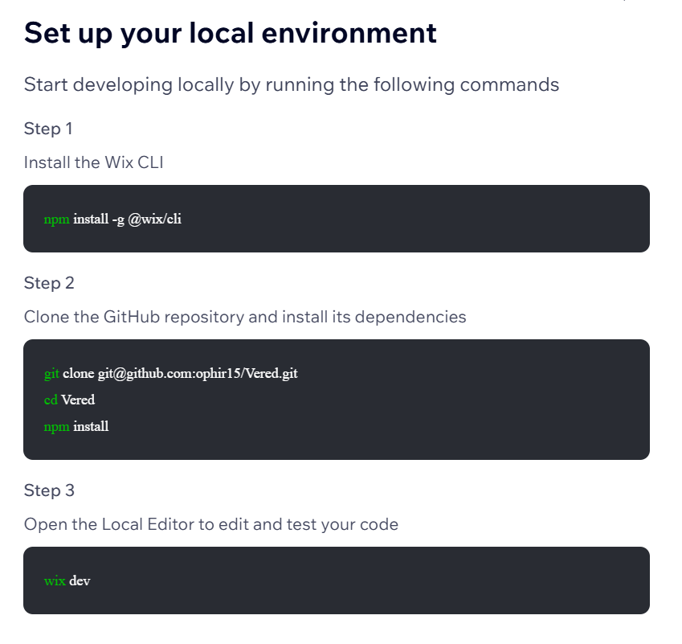

# Set up your local environment

Start developing locally by running the following commands.

These are the commands Wix showed for the **Vered** site GitHub integration.



## Step 1

Install the Wix CLI

```bash
npm install -g @wix/cli
```

## Step 2

Clone the GitHub repository and install its dependencies

```bash
git clone git@github.com:ophir15/Vered.git
cd Vered
npm install
```

HTTPS clone (if you do not use SSH keys):

```bash
git clone https://github.com/ophir15/Vered.git
cd Vered
npm install
```

## Step 3

Open the Local Editor to edit and test your code

```bash
wix dev
```

## Run it from this folder

From `wix agents/`:

```bash
bash scripts/setup-local-wix.sh
```

That script installs the CLI, clones `Vered` next to these files (ignored by git so it stays a separate repo), runs `npm install`, then prints the `wix dev` command.

`wix dev` opens a browser and needs your machine. A Cloud Agent can clone and edit `Vered`; it cannot usefully run the Local Editor GUI.

## After clone

Point Cursor Cloud Agents at **https://github.com/ophir15/Vered** (grant the Cursor GitHub app access to that private repo). This kit stays the agent how-to; `Vered` is the live site code.
